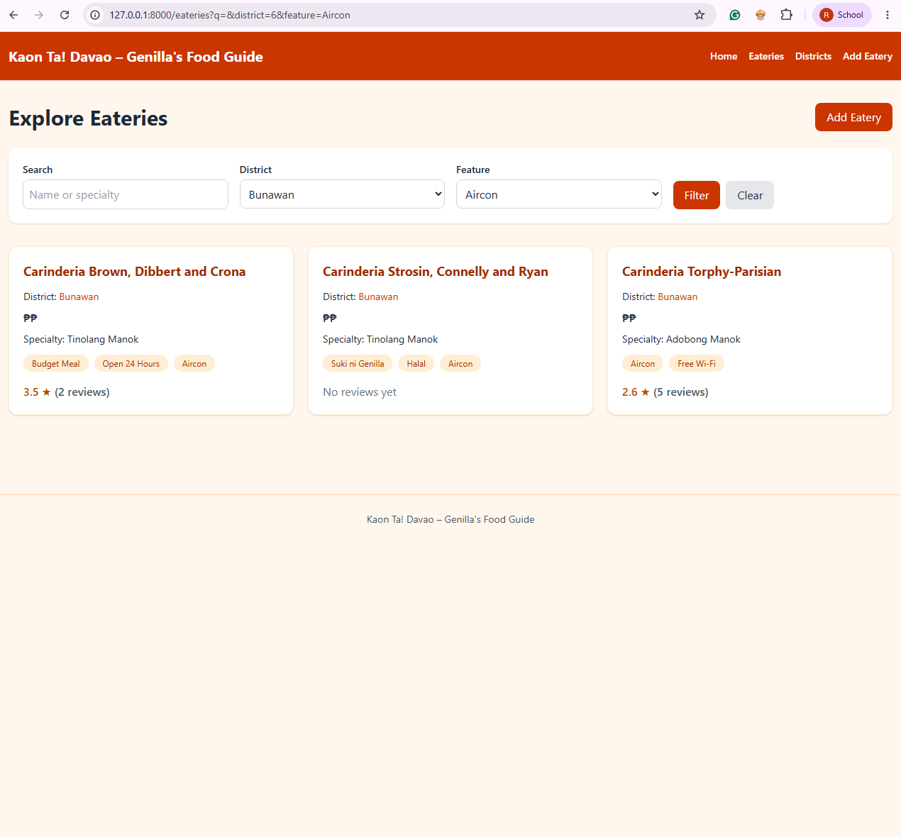
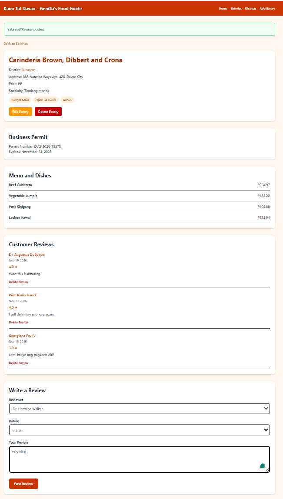
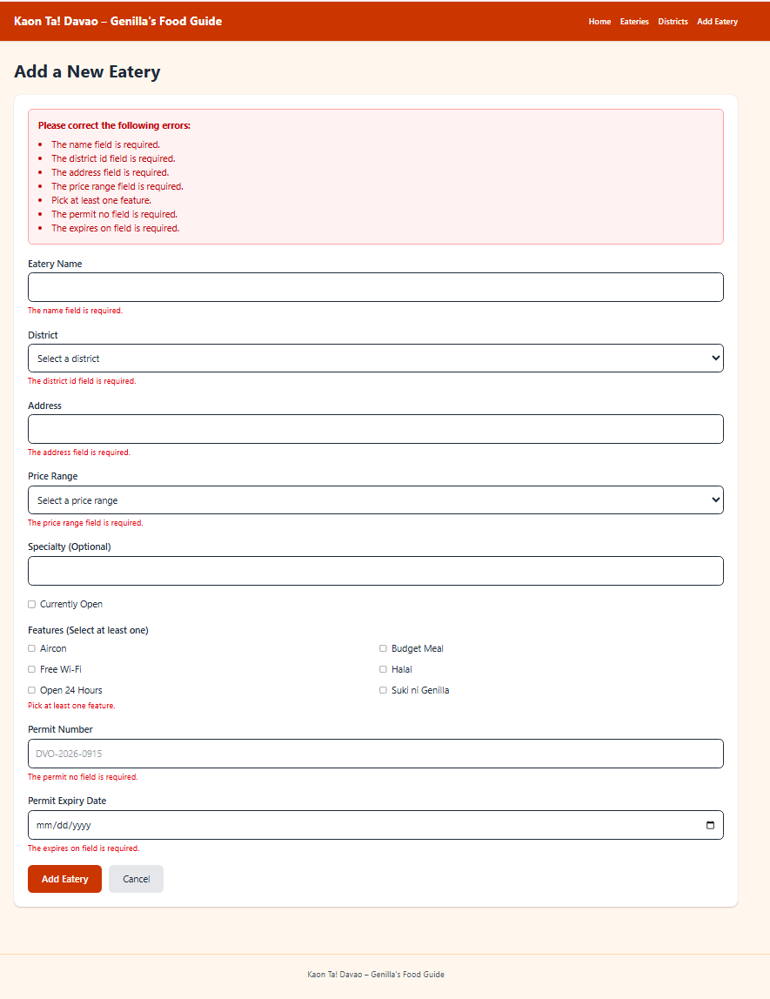

# Kaon Ta! Davao – Genilla's Food Guide

**Student:** Red Isaac Genilla  
**Project:** Prefinal Milestone Project  
**Course:** CS Elective 2 – Full-Stack Development  
**Framework:** Laravel 12  
**Database:** SQLite

## Project Description

Kaon Ta! Davao is a carinderia and eatery guide for
Davao City. It lets visitors browse eateries by district,
search for food specialties, filter by features, and view
menus, permits, and customer reviews.

The application also supports adding, editing, and
deleting eateries, as well as posting and deleting reviews.

No login is required for this project.

## Technologies Used

- PHP and Laravel 12
- SQLite
- Blade templates
- Tailwind CSS
- Vite
- Eloquent ORM
- Git and GitHub

## Installation and Setup

Requirements:
- PHP with SQLite support
- Composer
- Node.js and npm

Clone the repository:

```bash
git clone https://github.com/RedGenilla/PrefinalProject-Genilla-KaonTaDavao.git
cd PrefinalProject-Genilla-KaonTaDavao
```

Install PHP dependencies:

```bash
composer install
```

Create the environment file:

```bash
cp .env.example .env
```

Generate the application key:

```bash
php artisan key:generate
```

Set the database connection in `.env`:

```env
DB_CONNECTION=sqlite
```

Create the SQLite database:

```bash
touch database/database.sqlite
```

Run migrations and seeders:

```bash
php artisan migrate:fresh --seed
```

Install frontend dependencies:

```bash
npm install
```

Build frontend assets:

```bash
npm run build
```

Start the application:

```bash
php artisan serve
```

Open http://127.0.0.1:8000 in your browser.

On Windows PowerShell, use `Copy-Item` instead of
`cp` if preferred, `New-Item` instead of `touch`,
and `npm.cmd` if npm.ps1 is blocked.

## Personalized Seed Data

### Districts

1. Poblacion
2. Talomo
3. Agdao
4. Buhangin
5. Toril
6. Bunawan

### Features

1. Suki ni Genilla
2. Budget Meal
3. Halal
4. Open 24 Hours
5. Aircon
6. Free Wi-Fi

### Personalized Users

| Name | Email |
|---|---|
| Red Isaac Genilla | genilla@kaonta.test |
| Tita Genilla | tita.genilla@kaonta.test |

Both seeded accounts use the password `kaonta2026`,
stored as a hash. No login is implemented.

### Personalized Eatery

| Field | Value |
|---|---|
| Name | Carinderia ni Genilla |
| Slug | carinderia-ni-genilla |
| District | Poblacion |
| Address | San Pedro St., Poblacion, Davao City |
| Price Range | budget |
| Specialty | Tinolang Manok |
| Status | Open |
| Permit Number | DVO-2026-0915 |
| Permit Expiry | September 15, 2027 |

The eatery has the Suki ni Genilla and Budget Meal
features.

### Dishes

| Dish | Price | Bestseller |
|---|---|---|
| Tinolang Manok | PHP 85.00 | Yes |
| Kinilaw na Tuna | PHP 120.00 | No |
| Durian Shake | PHP 75.00 | No |

### Personalized Review

Reviewer: Tita Genilla

Rating: 5 stars

Review: Lami kaayo! Balik-balikan ni Tita Genilla.

## Database Relationships

| Relationship | Type | Purpose |
|---|---|---|
| District - Eatery | hasMany / belongsTo | A district contains multiple eateries, and each eatery belongs to one district. |
| Eatery - Dish | hasMany / belongsTo | An eatery can list several dishes, each belonging to one eatery. |
| Eatery - Review | hasMany / belongsTo | Each eatery can receive multiple customer reviews. |
| User - Review | hasMany / belongsTo | A reviewer can write multiple reviews. |
| Eatery - Feature | belongsToMany | Eateries can have multiple features, and features can belong to multiple eateries through eatery_feature. |
| Eatery - Permit | hasOne / belongsTo | Each eatery has one business permit containing its number and expiry date. |
| District - Review | hasManyThrough | A district can access reviews through the eateries belonging to it. |

## Application Routes

| Method | URI | Route Name |
|---|---|---|
| GET | / | home |
| GET | /eateries | eateries.index |
| GET | /eateries/create | eateries.create |
| POST | /eateries | eateries.store |
| GET | /eateries/{eatery} | eateries.show |
| GET | /eateries/{eatery}/edit | eateries.edit |
| PUT/PATCH | /eateries/{eatery} | eateries.update |
| DELETE | /eateries/{eatery} | eateries.destroy |
| POST | /eateries/{eatery}/reviews | eateries.reviews.store |
| DELETE | /reviews/{review} | reviews.destroy |
| GET | /districts | districts.index |
| GET | /districts/{district} | districts.show |
| GET | /reviewers/{user} | reviewers.show |

Verify the routes with:

```bash
php artisan route:list --except-vendor
```

## Screenshots

### Eatery Listing



### Eatery Details and Reviews



### Create Form Validation



## Validation and Features

- Required and unique eatery names
- Valid district and feature selections
- Permit number format and future expiry validation
- Review ratings from 1 to 5
- Minimum review length of 10 characters
- Reviews blocked for closed eateries
- Validation messages with retained form inputs
- Eager loading to avoid unnecessary database queries
- Search, filtering, and pagination
- Slug-based eatery URLs

## Author

Red Isaac Genilla

